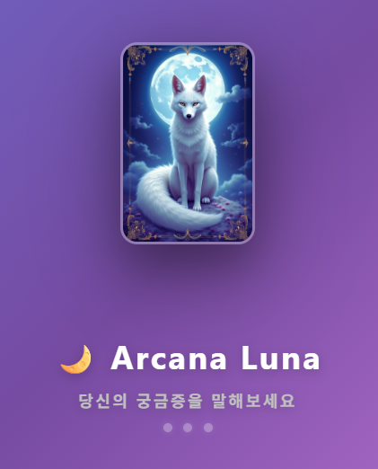
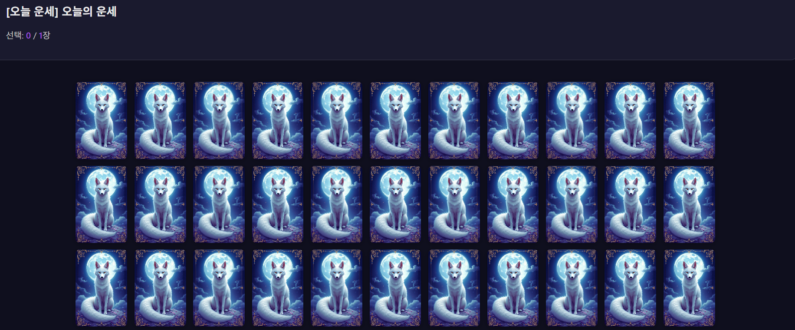
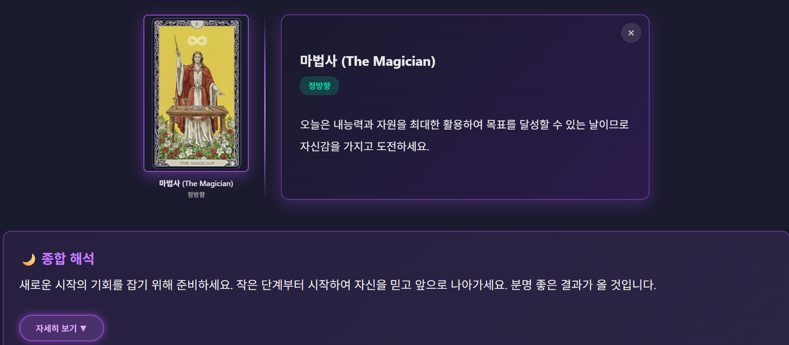

# Arcana Luna — AI 타로 리딩

> **"신비로운 달빛 아래 당신의 운명을 읽어드립니다."**

**[타로카드 보러가기](https://arcanaluna.r-e.kr)** | **[Render 미러](https://tarot-1d7z.onrender.com)**

---

## 스크린샷

| 메인 페이지 | 카드 뽑기 | AI 해석 결과 |
|:-----------:|:---------:|:------------:|
|  |  |  |

---

## 왜 만들었는가

타로 리딩 앱은 많지만, 대부분 **고정된 카드 해설을 그대로 보여주는 사전** 수준에 머물러 있습니다. 같은 카드를 뽑아도 "연애가 고민인 사람"과 "이직이 고민인 사람"에게는 완전히 다른 이야기가 필요한데, 기존 앱들은 그 차이를 만들어내지 못합니다.

**Arcana Luna**는 이 문제를 해결하기 위해 만들었습니다.

- 사용자의 **질문 맥락**을 AI가 분석하여 **매번 고유하고 깊이 있는 해석**을 생성
- 해석이 끝난 뒤에도 **실시간 대화를 이어가며** 추가 카드를 뽑거나 더 깊은 조언을 얻을 수 있음
- 복잡한 회원가입이나 로그인 없이 **누구나 즉시 무료로 이용** 가능

---

## 무엇을 만들었는가

### 78장의 완전한 타로 덱

전통 타로의 모든 카드를 포함합니다.

- **메이저 아르카나 22장** — 인생의 큰 전환점과 영적 여정을 상징 (바보, 마법사, 여사제, 여황제, 황제, 교황, 연인, 전차, 힘, 은둔자, 운명의 수레바퀴, 정의, 매달린 사람, 죽음, 절제, 악마, 탑, 별, 달, 태양, 심판, 세계)
- **마이너 아르카나 56장** — 일상 속 구체적인 상황을 다루는 네 가지 원소
  - **완드(지팡이)** 14장 — 불: 열정, 행동, 도전
  - **컵** 14장 — 물: 감정, 사랑, 관계
  - **소드(검)** 14장 — 공기: 사고, 갈등, 결단
  - **펜타클(동전)** 14장 — 땅: 돈, 건강, 현실

모든 카드는 **정방향과 역방향** 두 가지로 해석됩니다. 역방향은 단순히 "나쁜 의미"가 아니라, 에너지가 차단되었거나 내면화된 상태를 뜻합니다.

---

## 주요 기능

### AI 심층 해석 — 같은 카드, 다른 이야기

고정된 카드 사전이 아닙니다. Groq 기반 대규모 언어 모델(`openai/gpt-oss-120b`)이 **질문의 맥락, 뽑힌 카드, 배치 위치, 정/역방향**을 모두 고려하여 매번 고유한 해석을 생성합니다.

- "이직해야 할까요?"에서 뽑은 '탑' 카드와
- "연인과 화해할 수 있을까요?"에서 뽑은 '탑' 카드는 **완전히 다른 해석**이 나옵니다.
- 각 포지션별 개별 카드 해석뿐만 아니라, 전체 운의 흐름을 짚어주는 종합 조언을 제공합니다.

### 대화형 후속 질문 & 추가 카드

해석이 끝난 뒤 궁금한 점을 **AI에게 자유롭게 추가로 물어볼 수 있습니다.**
- "이 카드가 지금 상황에서 정확히 뭘 의미하는 건가요?"
- "상대방의 속마음에 대해 추가로 카드를 한 장 더 뽑아볼 수 있나요?"
- AI가 이전 리딩 맥락을 기억하고 매끄럽게 대화를 이어갑니다.

### 14가지 스프레드 — 질문에 맞는 최적의 배치

| 스프레드 | 카드 수 | 용도 |
|---------|--------|------|
| 원 카드 | 1장 | 오늘의 한마디, 빠른 답 |
| 쓰리 카드 | 3장 | 과거 → 현재 → 미래 |
| 조언 스프레드 | 3장 | 상황 → 장애물 → 해결책 |
| 라인 스프레드 | 5장 | 시간순 흐름 파악 |
| 크로스 스프레드 | 5장 | 핵심 문제 + 주변 맥락 |
| 양자택일 | 5장 | 두 선택지 비교 |
| 예/아니오 | 1장 | 직관적 답변 |
| 타이밍 | 3장 | 언제 행동해야 하는가 |
| 칠성 스프레드 | 7장 | 숨겨진 장애물 포함 분석 |
| 말발굽 스프레드 | 7장 | 인생의 큰 결정 |
| 켈틱 크로스 | 10장 | 가장 깊고 포괄적인 분석 |

질문을 입력하면 AI가 고민의 주제를 분석하여 **최적의 스프레드를 자동 추천**합니다.

### 점핑 카드

카드를 셔플하고 뽑는 과정에서 **낮은 확률로 돌발 카드가 튀어나옵니다.** 전통 타로에서 셔플 중 카드가 튀어나오는 현상을 디지털로 재현한 것으로, 무의식의 특별한 메시지로 함께 해석합니다.

### 감성적인 라이트 테마

별도의 복잡한 모드 설정 없이, 타로 리딩의 신비로운 분위기를 온전히 느낄 수 있는 **단일 라이트 테마**를 적용했습니다. 부드러운 양피지 톤과 서정적인 비주얼로 몰입감을 높였습니다.

### 간편한 즉시 사용

- 회원가입이나 로그인 절차 없이 **방문 즉시 무료로 리딩 시작**
- 불필요한 개인정보를 요구하지 않는 간결한 사용자 경험

---

## 기술 스택

| 구분 | 기술 | 선택 이유 |
|------|------|----------|
| **백엔드** | Python 3.11 + Flask | 가볍고 빠른 REST API 서버 구축 |
| **프론트엔드** | Vanilla JS + HTML5 + CSS3 (MPA) | 프레임워크 없는 가볍고 빠른 로딩, 높은 호환성 |
| **AI 엔진** | Groq API (`openai/gpt-oss-120b`) | 120B 대규모 모델을 통한 깊이 있는 해석 + 초고속 추론 |
| **최적화** | API 키 로테이션 + 인메모리 캐시 (TTL 1h) | 트래픽 분산 및 동일 질의에 대한 빠른 응답 속도 |
| **데이터베이스** | Supabase (PostgreSQL) | 서버 관리 및 안정적인 데이터베이스 연동 |
| **배포** | Render (싱가포르) + Gunicorn | 아시아 리전 저지연 서빙 |
| **PWA** | Service Worker + Manifest | 모바일 홈 화면 설치 및 정적 자산 캐싱 지원 |

---

## 라이선스

본 프로젝트는 [Apache License 2.0](https://www.apache.org/licenses/LICENSE-2.0)을 따릅니다.  
AI 추론에 사용된 `openai/gpt-oss-120b` 모델 역시 Apache 2.0 라이선스 및 OpenAI gpt-oss 이용 정책(Usage Policy)을 준수합니다.
